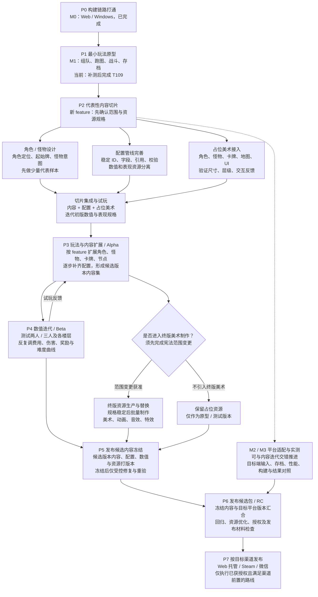

# Plan 001：核心循环

> 对应 CodeBuddy Plan 模式产物。技术细节只写在这里，不写进 `spec.md`。
> 状态：Confirmed —— T006 复盘完成（风险结论见 §6），M0 阻塞项按**宪法 v0.2** 判据（Web + Windows 两端打通）已全部完成。微信小游戏 T003 因版号/合规成本按用户指示延后，不计入 M0 阻塞（构建产物已在 M0 生成）。据宪法 C-7 + `spec.md` AC-6（v0.2 口径），状态由 Draft 改为 Confirmed，解锁 M1。

关联：`spec.md` FR-1 ~ FR-20 / AC-1 ~ AC-24

## 1. 技术选型

| 项 | 选择 | 备注 |
|---|---|---|
| 引擎 | Cocos Creator 3.8.8 | T001 实测回填（`C:\ProgramData\cocos\editors\Creator\3.8.8\CocosCreator.exe`） |
| 语言 | TypeScript `strict` | 宪法 C-1 |
| 核心逻辑单测 | **Node 内置 `node:test` + `node:assert/strict`，Cocos 内置 tsc 预编译** | T103 定稿：**零 npm 依赖**（不装 Vitest/tsx，不动 Cocos 管理的 `package.json`）。`build/scripts/test-core.ps1` 用 `C:\ProgramData\cocos\editors\Creator\3.8.8\...\tsc.js` 以 `--strict` 编译 `assets/core/*.ts` + `tests/core/*.test.ts` 到 `temp/test-build/`（已忽略），再 `node --test` 跑编译产物。测试源码在 `tests/core/`（入库）。兼容 Cocos：用其自带 tsc、不改 Cocos 配置 |
| 构建 | 编辑器构建面板 / 命令行构建脚本为主 | 由 T005 沉淀到 `build/`；构建参数无法由 MCP 配置，见 §4 |
| 版本控制 | Git | 构建产物、`library/`、`temp/`、`local/` 不入库 |
| 验证工具 | 浏览器 / 微信开发者工具 / Windows exe | 三端各自留验证记录；Web 预览已可由 MCP 启动 |

## 2. 架构分层

```
平台输入 ──> game/ 组件 ──> GameInput ──> core/ 状态机 ──> Snapshot ──> game/ 渲染
                                │                              │
                                └──────> PlatformAdapter <──────┘
                                  Storage / Input / Audio / Achievement / Share
                                  web/      wx/      win/
```

- `core/` 为纯函数式状态推进：`advance(state, input, ctx) -> { state, snapshot }`，`ctx` 注入 `Clock` / `Rng`。
- `game/` 不持有业务状态，只订阅 `Snapshot` 做渲染；所有输入先转成 `GameInput`。
- `PlatformAdapter` 在启动时按构建目标注入一次实现，业务层只见接口。
- **T110 鼠标交互**：沿用 StartMenu 和 GameSession，在 GameRoot 的 Canvas 内用 MapPage/BattlePage/RewardPage/SettlementPage 显隐切页；enemy 在左、party 按原顺序置于右。BattleSelection 为纯 TS 临时选卡对象（uid），只产出合法 GameInput，选卡/信息展示不推进、不存档。Cocos EventMouse.getLocation → Canvas.cameraComponent.screenToWorld → UITransform.convertToNodeSpaceAR 做节点命中，避免 fitWidth 下可见高度与设计高度不一致造成偏移；Web 层提供画布右键菜单抑制及释放函数，由 StartMenu 生命周期安装/清理，不在 game/core 引入浏览器全局。右键移动仍委托 advance 校验。提供结束回合、取消、奖励和重开按钮；verify-web.js 改为纯鼠标验收，原 T108 证据保留。
- **T111 多层地图**：GameConfig.floorCount（新局默认3，可选3/4/5；1只兼容旧档/单层测试）、GameState.floor（从1开始）与completedMaps（仅已完成楼层，当前map为唯一权威），Snapshot展示floor/floorCount。非最终boss致命出牌后归弃剩余手牌、清空能量/格挡、归档当前图，再用现有注入RNG生成下一层，HP/alive与牌UID不变；不重跑initGame、不增加boss奖励/难度。SaveData schema升级2，原key保持稳定，core.decodeSaveData将完整旧schema1单层档迁移为floor=1/floorCount=1，不把旧胜利改写为三层；新版校验楼层与历史地图长度，RNG状态续接。GameRoot楼层变化重新生成节点UI、清临时信息/选卡；Inspector可配置层数，鼠标验收扩展到所有楼层。
- **T112 组队**：GameConfig.startingParty可选（有序CharacterDef，id/颜色/专属起始牌），core先校验人数2~3/唯一id/颜色/牌引用，再初始化所选角色与合成牌组；无字段旧配置保留红蓝和startingDeck。组队是会话创建前临时UI，不新增core阶段；TeamSelection记录有序角色选择，TeamPage提供确认和继续旧档。GameSession.readSave只读校验/迁移存档，不初始化、不覆盖。确认新阵容创建并存档，继续直接恢复，重开返回组队且保留已结算档至确认。schema2添加可选角色配置并校验与实际party匹配；三人UI动态布局/绿色文案，原红蓝奖励池不变。
- **目录现状偏差（2026-11-16，T001）**：宪法 §3 将场景归 `assets/game/`，但 M0 smoke test 的两张场景实际位于 `assets/scenes/`（T001b 建立的布局，T002/T004 的构建配置已引用该路径）。为避免破坏已验证的三端构建链路，M0 阶段保留此布局；M1 正式实现（T106）时再把场景归位到 `assets/game/`，并同步更新 `builder.json` 构建任务的场景路径。四大分层 `core/`、`platform/{web,wx,win}/`、`game/`、`resources/` 已建齐（T001）。

## 3. PlatformAdapter 接口（T105 定稿）

契约定义在 `assets/core/platform.ts`（core 定义端口、platform 实现，保持 core 不依赖下层）；三端实现在 `assets/platform/{web,wx,win}/index.ts`。启动时按构建目标注入一次 `PlatformAdapter`（plan §2）。

| 接口 | 定稿签名 | Web 实现 | 微信小游戏 | Windows |
|---|---|---|---|---|
| `StoragePort` | `get(key): string \| null` / `set(key, value): void` / `remove(key): void` | `localStorage` 真实读写 | 内存 Map（空实现） | 内存 Map（空实现） |
| `InputPort` | `onEvent(handler): void` / `offEvent(handler): void`，事件 `PlatformInputEvent { kind:'key'\|'pointer', key?, x?, y? }` | `keydown` + `pointerdown` 归一化 | no-op（空实现） | no-op（空实现） |
| `AudioPort` | `play(clipId)` / `stop(clipId)` / `setVolume(volume)` | no-op（M1 无音频资源） | no-op | no-op |
| `AchievementPort` | `unlock(id): void` | no-op | no-op | Steamworks（M3） |
| `SharePort` | `share(payload: SharePayload): void` | warn（未实现） | `wx.shareAppMessage`（M2） | no-op |

`PlatformAdapter = { storage, input, audio, achievement, share }`，工厂 `createWebAdapter()` / `createWxAdapter()` / `createWinAdapter()`。空实现是合法实现，保证 M1 接口完整、三端可编译。Cocos tsconfig 无 DOM lib，Web 实现用最小 `declare` 声明所需浏览器全局；AC-4 白名单：`assets/platform/` 允许平台 API（core/game 仍禁止）。验证：`test-core.ps1` 追加 Cocos 配置（ES2015）三端类型检查，exit=0。

## 4. 构建与验证流程（T005 回填）

M0 实测（2026-11-09，通过 cocos-mcp-server）：

- 服务连的是 `rougeCard`（`D:\dev\rougeCard\rougeCard`），157 个工具；asset db 与 builder 均 `ready`。
- **`project_get_build_settings` 明确返回限制**：`Full build configuration requires direct Editor UI access`。原版插件里 `start_preview_server` / `stop_preview_server` 是空 stub、`run_project` 只调 `builder:open`。**构建参数至今仍需构建面板 / 命令行配置**，T005 的脚本要覆盖这一点。
- **预览已打通（实测通过）**：编辑器内置扩展 `builtin/preview/package.json` 提供 `open-terminal`（菜单 `Project > Preview` / Ctrl+P）、`query-preview-url`、`reload-terminal`、`preview-scene-in-browser`、`change-platform` 等消息。已本地修改 `cocos-mcp-server` 的 `source/tools/project-tools.ts`，用插件自带 `node_modules/.bin/tsc.cmd -p tsconfig.json` 重编译 `dist`：
  - `run_project` / `start_preview_server` → 依次尝试 `preview:open-terminal` → `open` → `preview-scene-in-browser`，成功后调 `query-preview-url` 把地址放进 `data.url`。
  - 重启编辑器项目（PID 16796，17:37:52，晚于 dist 产物 17:36:26）后实测：`run_project` → `success:true` / `Preview started via preview:open-terminal` / `url = http://192.168.255.10:7456`；7456 端口由编辑器主进程监听；`GET http://127.0.0.1:7456/` → 200（16457 bytes）；`debug_get_console_logs` → 0 条。
  - `stop_preview_server` 仍返回 `success:false`：内置扩展**没有 stop 消息**，预览服务器由编辑器托管，只能关预览页或用 `reload-terminal` 刷新。
  - `run_project` 的 `platform` 参数目前只回显，不切换平台（切换需接 `preview:change-platform`，参数格式未验证）；`start_preview_server` 的 `port` 被忽略，端口由编辑器预览设置决定。
  - 改动范围仅 `D:\dev\rougeCard\rougeCard\extensions\cocos-mcp-server`；`C:\Users\Administrator\AnimalStore` 的原件保留为回滚备份。
- **黑屏根因与修复（实测 2026-11-09）**：MCP `node_create_node` 创建的节点 `_layer = 1073741824`（DEFAULT），而 UI 相机 `_visibility = 41943040`（UI_2D | UI_3D），UI 渲染器被相机剔除，只剩清屏色。对照 `AnimalStore/assets/scene/MainScene.scene`：Canvas 及 UI 子节点均为 `_layer = 33554432`（UI_2D），相机 `_clearFlags = 7` / `_visibility = 1108344832` / `_far = 2000`。已用 `node_set_node_property { layer: 33554432 }` 修正 Canvas、Camera、TitleLabel、StartButton 四个节点，并把相机三项调成标准值。**今后用 MCP 新建 2D UI 节点必须显式设 `layer = 33554432`**，否则必黑屏。
- **构建面板 `Run` 与编辑器预览的区别**：`Run` 跑的是 `build/web-desktop` 里的产物；场景 17:45:57 修改、构建目录却停在 17:28:50，改场景后不重新 Build 就一直看到旧包。编辑器预览（`project_run_project` / Ctrl+P）用 `settings.js?scene=current_scene` 实时加载当前场景，无需 Build，是更快的验证途径。
- `/api/tools` 返回的 `curlExample` 端口写死 8585（文档残留），实际服务端口 3000，不可照抄。
- 项目初始场景未保存为资源（`scene_get_scene_list` 返回空），须先 `scene_save_scene` 才能进 Build Settings；设计分辨率 1280×720、`fitWidth: true`（横屏），已回填 `spec.md` Q-2。
- REST 调用必须用 UTF-8 字节数组传 Body；`component_attach_script` 常返回 `success:false` 但实际已挂载，用 `component_get_components` 确认（组件类型显示为脚本 cid）。
- `component_set_component_property` **必须显式传 `propertyType`**，合法值是小驼峰白名单：`string` / `number` / `integer` / `float` / `boolean` / `color` / `vec2` / `vec3` / `size` / `node` / `component` / `spriteFrame` / `prefab` / `asset` / `nodeArray` / `colorArray` / `numberArray` / `stringArray`。不传会报 `Unsupported property type: undefined`；组件引用（`cameraComponent`）用 `propertyType: 'component'` 且 `value` 传**目标组件所在节点的 UUID**。
- `debug_validate_scene` 传 `checkMissingAssets` / `checkPerformance` 会报 `Message does not exist: scene - check-missing-assets`；**空参调用**才返回 `valid: true`。
- **MCP REST 传非 ASCII 会乱码**：中文写入 `cc.Label.string` 变成 `å¼å§æ¸¸æ`（UTF-8 字节被按单字节解码），`\uXXXX` 转义亦无效。smoke test 文案统一用 ASCII；中文文案需编辑器 UI 设置或由 TS 脚本赋值。
- `debug_execute_script` 不是自由 JS 执行（报 `Scenario scripts do not exist: console`），不要依赖它批量建节点。

> Web 已由 T002 实测回填；微信小游戏 / Windows 仍待 T003–T005 实测回填，不允许凭记忆写死。

| 端 | 构建方式 | 验证方式 | 命令 |
|---|---|---|---|
| Web / H5 | 编辑器 Build 面板：目标 `web-desktop`，初始场景 `StartMenu`，场景列表含 `StartMenu` + `Placeholder`，输出 `build/web-desktop`（MCP 无自动构建 API，T005 沉淀脚本） | 本地静态服务器 + Edge；T108 用真实鼠标/键盘跑完整一局，记录 Snapshot/Label 与控制台错误 | `powershell -NoProfile -ExecutionPolicy Bypass -File build/scripts/serve-web.ps1`（仅监听 127.0.0.1:8123）<br>`playwright-cli -s=t108 open --browser=msedge http://127.0.0.1:8123/`（新建隔离会话）<br>`playwright-cli -s=t108 run-code --filename d:/dev/rougeCard/rougeCard/build/scripts/verify-web.js`（T116实测CLI支持文件输入，避免Windows长参数限制；按待验任务选择URL参数和独立会话） |
| 微信小游戏 | 编辑器 Build 面板 `wechatgame` 任务（输出 `build/wechatgame`）；AppID 占位 `wx6ac3f5090a6b99c5`（T003 产物核验）。**待修**：`game.json` 竖屏 `deviceOrientation: portrait`（Q-2 要求横屏）；`program.json` 尚未配置微信开发者工具路径。**T003 按宪法 v0.2 延后**（版号/合规成本），不计入 M0 阻塞；构建产物已生成 | 微信开发者工具导入 `build/wechatgame` + 真机点 START 验证（延后至发行阶段执行） | 构建：编辑器 Build 面板点 `wechatgame` 的 Build；导入：微信开发者工具打开 `build/wechatgame` 目录 |
| Windows | 编辑器 Build 面板 `windows` 任务（target `x64`，`nativeCodeBundleMode: wasm`，输出 `build/windows`）；MCP 无法配置构建参数（见 R-6）。**须把该任务启动场景设为 `StartMenu`（uuid `207c2746-...`），默认错配成空场景 `Placeholder`**（用户 2026-11-16 已改好） | **用入库脚本启动**：`powershell -File build\scripts\run-windows.ps1`（自动建 data 链接后启动 exe）；仅建链接不启动加 `-NoLaunch`。原理：exe 只读 exe 同级 `data`（junction → `build/windows/data`），不读 cmake `copy_resource` 的 `proj/Release/Resources`（陈旧副本，`launchScene` 仍为 Placeholder）。真实桌面点 START 验证跳转 | 编译 `cmake.exe --build build\windows\proj --config Release --parallel 8`；启动 `powershell -NoProfile -ExecutionPolicy Bypass -File build\scripts\run-windows.ps1` |

### 干净检出可重复构建流程（T005，2026-11-16）

构建任务配置由编辑器 Build 面板管理，存于 `profiles/v2/packages/builder.json`（`profiles/` 被 `.gitignore` 排除，属本机状态）；入库的 `settings/v2/packages/builder.json` 只是空壳。因此干净检出后**没有构建任务**，这就是"可重复构建"的障碍。T005 的处理：

- **配置模板入库**：`build/config/builder.json.template`（从实测三端任务导出，无本机绝对路径，场景用 `db://` URL + UUID）。含 web-desktop / wechatgame / windows 三任务。
- **恢复脚本**：`build/scripts/setup-build-config.ps1`，**关闭编辑器后**运行，把模板拷回 `profiles/v2/packages/builder.json`（自动备份原文件为 `.bak`，`-Force` 跳过确认）。实测：恢复后文件 hash 与模板一致；脚本会警告编辑器运行中可能被覆盖。
- **三端启动/服务脚本**：`run-windows.ps1`（data 链接 + 启动 exe，T004b）、`serve-web.ps1`（封装 T002 验证的 `C:\Python313\python.exe -m http.server 8123`，实测 HTTP 200）。微信端无脚本，按上表在微信开发者工具导入。
- **人工步骤不可消除**：构建本身仍须在编辑器 Build 面板点选（MCP 无法配置构建参数，R-6）；恢复配置后打开编辑器，确认三任务的启动场景为 `StartMenu`（windows 任务曾被错配为 `Placeholder`，见 T004）。真实"可重复"= 模板恢复配置 + 脚本启动验证 + Build 面板点 Build 三步。

T106 核心玩法画面实测（2026-11-17，Cocos 预览 + playwright-cli/Edge）：启动预览（`project_run_project`，URL `http://127.0.0.1:7456/`），点击 START（canvas 内命中点约 (592,400)，M0 记录 GameDiv 1280×960 有坐标偏移）→ `[StartMenu] start clicked - booting core game` → GameRoot 动态建 UI。方向键移动两格进入战斗，画面实时显示：六边形地图（金=当前/蓝=战斗/绿=休息/红=boss）、PARTY（红/蓝 hp 30/30、能量 r1 b1）、ENEMY normal hp 12/12 intent attack 3、HAND 5 张牌、顶部阶段/回合/rev、底部操作提示。**0 console 错误**，证明输入→core.advance→Snapshot→渲染链路打通。证据 `specs/001-core-loop/CoreGame-Battle.png`。注意：这是编辑器预览验证；真实 Web 构建产物由 T108 验证。

T108 H5 实包全流程（2026-11-17）：用户手动构建成功，`build/web-desktop/assets/main/index.js` 修改时间13:45:37，包含当前 GameRoot/存档/奖励展示。`serve-web.ps1` 启动仅本机 HTTP 服务，访问 `http://127.0.0.1:8123/` 返回200。`build/scripts/verify-web.js` 在新建 Edge 会话中执行，使用 Camera.worldToScreen + canvas 矩形定位 START，仅读 Snapshot/Label，鼠标点击与15次合法键盘操作走通：开始 REV0 → 普通战斗 REV2 → 奖励 REV6 → 选 Red Strike、牌组+1、地图 REV7 → boss REV9 → 第3回合胜利 REV17（红 HP17、蓝 HP30）。浏览器 console/pageerror 和 HTTP 错误均0；另实测结算后冻结、R 重开 MAP/REV0。证据：`H5-AC2.json` 与 `H5-{StartMenu,NormalBattle,Reward,BossBattle,Victory}.png`。**AC-2 通过；用户已确认 Q-5 为仅本机静态托管、不上传外部站点，并授权创建本地 Git 检查点（不 push）；T108 已勾选。** 默认 HTML 容器1280×960未改，验收视口1280×1080，小窗口可能需要滚动；设计分辨率仍1280×720/policy4。手机触控及外网部署不在本次验证中。

T110/T111 真实 Web 包联合复验（2026-11-17）：用户重新构建，`assets/main/index.js` 修改时间15:50:31（40518字节），包含MapPage/floorCount/completedMaps。`serve-web.ps1` 本机服务HTTP200；新建Edge会话 `t111-web` 打开 `http://127.0.0.1:8123/`，执行 `$code=Get-Content build/scripts/verify-web.js -Raw -Encoding UTF8; playwright-cli -s=t111-web run-code $code`。81次真实鼠标操作、0次键盘完成节点信息/非相邻拒绝/画布右键抑制、两步出牌与错误目标/取消、定向防御、战斗读档、普通奖励、逐层boss、2/3层地图中心与独立访问状态、层间读档→第3层最终胜利REV53（红HP17、蓝HP30）→重开MAP/REV0。console/pageerror/HTTP错误均0，结果 `AC-15~21 WEB PASS`（source=web-build）。证据 `Floors-AC15-21.json` 与 `Floors-{MapInfo,Battle,SelectedCard,Reward,Floor2,Floor3,Victory}.png`。37/37核心/交互/存档测试、三端adapter编译与分层检查通过；4/5层通关本次仅核心测试，未声称Web实测。T110/T111已完成；用户授权本次本地Git检查点（不push，按提交主题查找），T109未执行。设计分辨率仍1280×720/policy4，验收视口1280×1080，手机触控未验证。

T002 Web 构建产物实测补充（2026-11-09）：

- 产物 `src/settings.json`：`launchScene = db://assets/scenes/StartMenu.scene`、`designResolution = 1280×720 / policy 4`、`engine.debug = false`；`assets/main/config.json` 的 `scenes` 同时含 StartMenu 与 Placeholder，证明构建面板配置生效。
- 用户脚本以 SystemJS 模块打进 `assets/main/index.js`，`console.log` 在 `debug:false` 下**仍然保留**，可用作输入链路判据。
- `index.html` 把 `GameDiv` 写死为 1280×960，而设计分辨率是 1280×720、浏览器视口也是 1280×720，按钮屏幕坐标相对设计坐标有偏移且容器下半部分超出视口。`page.mouse.click` 扫描步长需 ≤24px；粗网格（128×77px）会整片漏掉按钮。实测命中点 `(592, 524)`。
- 判定场景跳转**不能只看截图**：`Placeholder` 是空场景，切换后 WebGL 不重绘，canvas 会残留 StartMenu 最后一帧。可靠判据是 `page.evaluate(async () => (await System.import('cc')).director.getScene().name)` 返回 `Placeholder`，或复点按钮不再产生 `[StartMenu] start clicked`。

## 5. 需求 → 实现映射

| 需求 | 落地模块 | 任务 |
|---|---|---|
| FR-1 | `core/` 初始状态 + `game/` 入口场景 | T102 / T106 |
| FR-2 | `GameInput` + `game/` 输入组件 | T102 / T106 |
| FR-3 | `core/advance` + `Snapshot` | T102 / T104 |
| FR-4 | `core/` 结算与冻结判定 | T104 |
| FR-5 | `Storage` 适配器 + 存档 schema | T102 / T105 / T107 |
| FR-6 | M1：确定性`Clock`/`Rng`注入、同配置/seed/时间/S1重复运行、三adapter工厂存储契约与恢复续接；真实三端对照留到平台实测 | T104 / T118 / T109；后续T202 / T302 |
| FR-7 | 分层约束与静态检查 | T106 / T109 |
| FR-8 | `core/` 地图生成（seed → 六边形地图，AC-7） | T102 / T104 |
| FR-9 | `core/` 移动规则（相邻六边形、节点触发） | T102 / T104 |
| FR-10 | `core/` 能量产出与清空规则 | T102 / T104 |
| FR-11 | `core/` 出牌支付与拒绝规则 | T102 / T104 |
| FR-12 | `core/` 牌堆抽牌与弃牌洗回 | T102 / T104 |
| FR-13 | `core/` 阵亡状态与牌组保留 | T102 / T104 |
| FR-14 | `core/` 敌人意图与攻击目标 | T102 / T104 |
| FR-15 | `core/` 格挡与伤害顺序 | T102 / T104 |
| FR-16 | `core/` 休息节点复活与恢复 | T102 / T104 |
| FR-17 | `core/` 奖励候选与选牌 | T102 / T104 |
| FR-18 | `game/GameRoot` 分页与鼠标命中、`game/BattleSelection` 临时选择、`platform/web` 右键菜单抑制；纯 TS 单测与真实鼠标浏览器验收（AC-15~18） | T110 / T109 |
| FR-19 | `core/state/engine/snapshot/save` 楼层配置/逐层boss/层间保留/schema2迁移，`game` 配置与页面刷新；floors.test.ts、verify-web.js（AC-19~21） | T111 / T109 |
| FR-20 | `core/team/state/engine/save` 有序队伍配置/校验/初始化；`game/TeamSelection/GameRoot` 会话前选择/继续/重开与三人UI，`GameSession.readSave`只读存档；team-selection.test.ts、verify-web.js（AC-22~24） | T112 / T109 |

> FR-8 ~ FR-17 均为 `core/` 纯 TS 规则（Q-1 玩法设定，spec §1.1/§1.2），由 T102 定义类型、T104 实现确定性推进并补单测、T109 按 AC-7 ~ AC-14 验收。T106 只负责渲染 `Snapshot`，不承载规则。

T109证据补强映射：FR-9→T113（已访问节点），FR-10/11/13→T114（剩余能量与阵亡卡手），FR-14/15→T115（格挡吸伤/跳过死亡目标），FR-4及FR-19结算冻结→T116，FR-5/19旧失败档→T117，FR-6→T118（仅三adapter进程内契约）。补测复用现有Node测试/Cocos tsc、注入Clock/Rng与受控状态夹具，不改玩法、不引入依赖或平台运行时判断；三adapter工厂只在测试边界实例化，Web测试环境留在测试层。固定同一配置/seed/S1按dispatch逐步序列化对比，并从各StoragePort恢复后续RNG。

用户已确认分阶段验收，spec FR-6/AC-1先行修订：M1保留核心重复运行与T118三adapter进程内存储契约，真实三端对照按spec§6延后至平台适配后的验收。当前Windows/微信适配器为内存storage与no-op input，StartMenu仅组合Web storage；测试中实际实例化三工厂，固定同一配置/seed/Clock时间/S1，通过GameSession.dispatch逐步比较序列化Snapshot，分别保存/恢复后与未中断运行比较后续Snapshot/Rng状态。Web测试环境仅放测试层，不改core/game、不引入新依赖。

M1契约不验证真实平台输入、原生持久化或真机运行，不能替代后续对照。真实平台验收由T202/T302记录，依赖T201/T301适配；需固定同一版本/config/seed/时间/S1并保留各端逐步与恢复后续证据。原排期阻塞已由用户确认的spec变更解除，不修改宪法v0.2/M0判据、不开始M2/M3；T118尚未执行，AC-1仍不能勾选通过。

## 6. 风险与验证项

| 编号 | 风险 | 验证时机 | 结论 |
|---|---|---|---|
| R-1 | 构建链路跑不通，架构假设不成立 | M0（T002–T004） | **通过（宪法 v0.2 口径）**：M0 阻塞判据为 Web + Windows 两端——Web 实包构建 + 浏览器运行 + 输入与场景切换通过（T002）；Windows 构建 + exe 启动 + StartMenu 显示与点击跳转通过（T004，用户真实桌面验收）。微信小游戏构建产物已生成（验证单一工程多端打包可行），真机/上架验证因版号合规延后（T003，不计入 M0 阻塞）。宪法 C-2/C-3 未被证伪 |
| R-2 | 纯 TS `core/` 与 Cocos `tsconfig` / 打包器冲突 | M0（T001）/ M1（T102/T104/T106） | **已验证通过**：T102/T104 写入纯 TS 类型与引擎（无 `cc`/平台 import），T106 由 `GameSession`/`GameRoot` 在真实 Cocos 预览中接入——cc 脚本编译无错、浏览器渲染地图/队伍/敌人/手牌、键盘输入经 core.advance 实时更新 Snapshot，0 console 错误（截图 `CoreGame-Battle.png`）。Cocos 项目 tsc `--noEmit --skipLibCheck` 项目代码 0 错误、16/16 core 单测通过。根 `tsconfig.json` `strict: true`（对齐宪法 C-1）。注：M1 仅预览验证，真实三端构建产物由 T108（Web）/后续打包验证 |
| R-3 | 微信小游戏首包体积与分包策略 | M2 | `[待回填]` |
| R-4 | Windows 包与 Steamworks SDK 的集成方式 | M3 | `[待回填]` |
| R-5 | task 粒度过大，无法独立验证导致 spec 流程失效 | 全程 | 约束：单 task 估时 ≤ 半天 |
| R-6 | MCP 能否替代三端构建与预览 | M0（实测） | 构建配置仍需编辑器 UI / 命令行；**预览已通过本地改插件打通**（`preview:open-terminal` + `query-preview-url`），重启后实测 200。MCP 稳定支持场景搭建、资源刷新、静态校验、日志读取、启动预览；无 stop 能力 |

R-1 未通过时，不得进入 M1 实现任务，先修订宪法 C-2 / C-3。**本次 R-1 已通过（v0.2 口径），已解锁 M1**；微信小游戏端风险转由发行阶段处理，不在此阻塞。

## 7. 里程碑

| 里程碑 | 目标 | 任务范围 |
|---|---|---|
| M0 | Web + Windows 打通并沉淀构建脚本（宪法 v0.2；微信端 T003 延后至发行阶段） | T001–T006（含 T001b；T003 延后不计入阻塞） |
| M1 | H5 demo可玩通一局、core确定性及三adapter进程内契约 | T101–T118（T109最终收尾，T113–T118补证据） |
| M2 | 微信小游戏适配与真机验收，对照同版本Web结果 | T201–T202 |
| M3 | Windows + Steamworks内部测试，补齐真实三端结果对照 | T301–T302 |
| M4 | 内容、打磨、上架材料 | T401 |

### 7.1 从当前原型到上线的项目流程图（建议路线，尚未拆为执行任务）

§2的图描述代码依赖；下图描述项目推进。P0～P7是制作阶段，不替换现有M0～M4编号。当前位于P1；美术、内容和数值不必等到M4才开始，但正式扩展需先为对应feature编写`spec.md`、`plan.md`、`tasks.md`，按单task循环实现。本图只规划时序，不授权制作资源、扩充玩法或部署发布。



### 7.2 关键制作线的接入与冻结时机

“设计”“接入”“冻结”是不同节点：设计可以早开始，接入必须能在真实游戏中验证，冻结是某一发布候选版本的基线，不意味着永远不改。每轮玩法/配置修改都回到`spec → plan → tasks → 实现 → 构建验证 → 证据/检查点`；此处不设未经确认的日期、内容数量或胜率目标。

| 制作线 | 何时开始 | 首次接入 | 何时完善 | 何时冻结 |
|---|---|---|---|---|
| 角色设计 | P1可讨论定位；P2正式设计少量代表角色，先明确颜色、起始牌、特色与队伍组合 | P2先用占位头像和基础牌试玩；新能力须走独立feature，不仅改一张配置表 | P3根据牌组流派、两人/三人组合逐批增加；表现设计随规则稳定细化 | P5冻结该候选版本角色名单、能力和起始牌；平衡参数按数值线冻结 |
| 怪物 / boss设计 | P2先定战斗职责和可读意图，不先画大量外形 | P2用普通怪/boss样本验证节奏、攻击目标与意图显示 | P3扩展敌人组合、行为和楼层分布；新增行为先实现规则与测试，再填配置 | P5冻结候选版本怪物名单、行为与配置引用 |
| 配置体系 | P1已有`GameConfig`与原型值；P2在规模化内容前完善管线 | P2建立稳定ID、字段类型/默认值、引用校验、加载及版本兼容方案；由外层加载为纯数据传入`core/` | P3补齐角色、牌、敌人、地图、奖励和资源映射；仅对已实现机制配数据，缺引用/非法值在构建或加载边界拒绝 | P2/P3先稳定结构；P5冻结内容数据及配置版本，结构变更另走兼容方案 |
| 数值 | P1只定能跑通的基线；现有HP30/攻击4/格挡3/费用1不是终版平衡结论 | P2定初版相对标尺：费用对应收益、敌人意图、休息/奖励收益和局长目标；目标值需另行确认 | P3/P4反复试玩与离线确定性模拟，覆盖阵容、seed、楼层；关注通关率、战斗回合数、损血、选牌倾向与卡手，不引入联网统计 | P5定候选版本基线；RC阶段只做有证据的受控修正，修改后重跑回归 |
| 美术 / 表现 | P1可做风格与资源规格讨论，不批量制作终版 | P2接入一套可替换占位资源：红绿蓝角色、普通怪/boss、卡牌框与图标、地图节点、按钮和背景；验证高亮/目标反馈，不改core规则 | P3稳定布局、尺寸、命名、锚点与动画接口；终版制作须先获范围变更批准，再依据稳定角色/怪物设计逐批替换；不等待所有数值定死才画 | P5冻结候选版本资源清单和映射；P6再做图集/压缩及目标端性能优化，不能在上线前才首次接入大批资源 |

资源统一放`assets/resources/`，由`assets/game/`加载并订阅`Snapshot`呈现；配置中的玩法数据与资源URL/映射分开，`assets/core/`不读取引擎资产或平台API。P2先做最小可替换管线，不预先写死未经实测的贴图尺寸、图集大小、分包或显存预算；目标端预算在M2/M3实测回填。

### 7.3 与现有范围和发布路线的关系

- **眼前顺序**：T113～T118补证据 → T109完成M1 → 建立P2代表性内容/占位美术feature。P3～P7为后续制作路线，不是本会话新增的实现任务；开放玩法逐条由后续spec承接，不一次性铺满全部内容。
- **并行关系**：角色/怪物定位、配置管线、占位美术可在P2分任务交错推进；先汇合出能玩的切片，再批量扩展。P3开始后，数值迭代持续进行；设计与表现规格稳定的资源可先制作，无须等最后一轮伤害数值冻结。平台实测尽早使用代表性资源，完整资源合入后仍须复测。
- **终版美术门槛**：宪法§1目前禁止引入终版美术；图中的终版分支只是条件路线。实际进入前须由用户批准并更新`constitution.md`§8，再级联相关spec/plan/tasks；本次不修改宪法、不授权终版制作。保留占位美术的版本仅按原型/测试版本定位。
- **平台路线**：M2微信适配/真机仍按既有约定延后；M3 Windows/Steam适配与内部测试依赖实际发行安排。不把微信上线作为Web/Windows发布的必需前置；选择某端发布，就需要该端冻结包的实测证据，M1进程内契约不能替代。
- **发布门槛位置**：M4/T401承接后续内容打磨和发布准备，具体可判定标准应写进后续feature spec，单步骤写进tasks；RC汇合冻结的内容/配置/资源与目标端构建，检查完整流程、存档兼容、授权、包体/性能、渠道材料后才安排发布。
- **授权边界**：当前Web仅本机静态托管，不自动上传外部站点。外网托管、Steam上传或微信发布均需另行确认目标渠道、权限与前置材料；不得顺带增加账号、服务端、内购或热更新。

## 8. 变更记录

| 日期 | 变更 |
|---|---|
| 2026-11-09 | 创建骨架，状态 Draft |
| 2026-11-09 | 回填 M0 实测：引擎版本 3.8.8、MCP 构建配置受限、R-1 部分结论、1280×720 横屏；状态仍为 Draft |
| 2026-11-09 | T001b 实测回填：预览不可用、`propertyType` 白名单与组件引用规则、`validate_scene` 空参、`attach_script` 假失败、非 ASCII 乱码；状态仍为 Draft |
| 2026-11-09 | 本地扩展 `cocos-mcp-server` 打通预览，重启编辑器后实测通过；更新 §4 与 R-6 结论；状态仍为 Draft（T002–T004 未完成） |
| 2026-11-09 | 定位并修复黑屏：MCP 新建 UI 节点 layer 为 DEFAULT 导致被相机剔除；补 layer=UI_2D 与相机标准参数后，浏览器实测画面、点击、场景切换全部通过；证据 `specs/001-core-loop/StartMenu-preview.png` |
| 2026-11-09 | T002 Web 构建产物实测回填：构建面板配置、静态服务器 + Edge 验证命令、SystemJS 读取当前场景名的判定方法；证据 `specs/001-core-loop/WebBuild-StartMenu.png`；状态仍为 Draft（T003–T006 未完成） |
| 2026-11-16 | T004 splash 根因排查：双因叠加（windows 构建任务启动场景错配空场景 Placeholder + exe 同级缺 data 资源链接），交叉对照实验确认；回填 §4 Windows 行与 tasks.md 证据表，新增 T004b 持久修复 |
| 2026-11-16 | T004 用户真实桌面验收通过，已勾选；截图 `WindowsBuild-StartMenu.png` 入库。用户已在 Build 面板把 windows 启动场景改为 StartMenu（源头已修）。T004b 查证 data 链接本质：exe 只读 `proj/Release/data`（junction → `build/windows/data`），不读 cmake `Resources`（陈旧副本 launchScene=Placeholder），删链接仅留 Resources 仍卡 splash——链接为必需条件 |
| 2026-11-16 | T004b 完成并勾选：新增入库脚本 `build/scripts/run-windows.ps1`（幂等建 data 链接 + 启动，`-NoLaunch` 只建链），实测通过；修正 `.gitignore` 使 `build/scripts/` 入库、三个产物子目录仍忽略（兑现宪法 §3）。`build-templates/`（native/wechatgame 构建模板）纳入版本控制。§4 Windows 启动命令改为该脚本 |
| 2026-11-16 | T001 完成并勾选：补齐宪法 §3 四大分层目录 `assets/core/`、`platform/{web,wx,win}/`、`resources/`（MCP 建目录 + `.meta` 入库）；引擎版本 3.8.8 双确认并回填 §1；§2 记录场景留在 `assets/scenes/` 的偏差与 M1 归位计划 |
| 2026-11-16 | T005 完成并勾选：构建任务配置模板 `build/config/builder.json.template` 入库 + `setup-build-config.ps1` 恢复脚本（解决 profiles 不入库导致干净检出无构建任务）；`serve-web.ps1`（实测 HTTP 200）；§4 回填微信行 + 干净检出可重复构建流程 |
| 2026-11-16 | T006 复盘：回填 §6 风险结论（R-1 通过、R-2 未实际验证待 M1 T102 实测）。初按三端口径保持 Draft；后应用户「版号太麻烦、提前进 M1」要求，经宪法 v0.2 变更收窄 M0 判据为 Web + Windows 两端，状态改为 **Confirmed**、T006 勾选，M1 解锁 |
| 2026-11-16 | **宪法 v0.2 变更**：微信小游戏因版号/类目/合规成本延后真机/上架验证，不计入 M0 阻塞（构建产物仍在 M0 生成）。级联更新：宪法 §1/C-7/§8、spec AC-6/§6、plan 状态与 R-1、tasks T003 转延后 / T006 收尾 |
| 2026-11-16 | T101 完成并勾选：Q-1 已确认关闭；`plan.md` §5 映射同步——补 FR-8~FR-17 共 10 条 core 规则映射、头部关联扩到 FR-1~17/AC-1~14、T109 验收范围同步 |
| 2026-11-16 | T102 完成并勾选：`assets/core/` 新增 7 个纯 TS 类型模块（GameState/GameInput/Snapshot/SaveData/契约签名），无引擎/平台 import；Cocos tsc `--strict` 检查 exit=0、CJS 编译后 node 可引用；根 `tsconfig.json` `strict:false`→`true` 对齐宪法 C-1；§6 R-2 更新为部分验证、风险降低待 T106 打包验证 |
| 2026-11-16 | T103 完成并勾选：单测框架定稿为零依赖 `node:test` + Cocos 内置 tsc 预编译（回填 §1）；新增 `build/scripts/test-core.ps1` 可重复命令与 `tests/core/init.test.ts` 首个用例（3 用例全过） |
| 2026-11-16 | T104 完成并勾选：`assets/core/` 新增 rng/map/engine 三个实现模块，落地 initGame/advance/buildSnapshot 全部 FR 规则；GameConfig 扩展 restNodes+EnemyDef；`tests/core/engine.test.ts` 13 用例覆盖 AC-7~14/FR-4/FR-16 + 判据两条；strict 编译 12 TS 通过、16/16 全过；§6 R-2 更新为逻辑层已验证、打包器待 T106 |
| 2026-11-16 | T105 完成并勾选：`assets/core/platform.ts` 定稿 PlatformAdapter 五端口契约；`assets/platform/{web,wx,win}/index.ts` 三端实现（Web 真实 Storage+Input，wx/win 空实现）；修复 T104 Array.includes→indexOf（ES2015）；test-core.ps1 追加三端类型检查；plan §3 接口草案→定稿 |
| 2026-11-17 | T106 完成并勾选：`assets/game/GameSession.ts`（state 仅经 core.advance 变更）+ `GameRoot.ts`（动态 UI 渲染 Snapshot + 键盘输入转发）；StartMenu 点击 START 动态挂载；新增 check-layering.ps1（AC-4 + dispatch-only 检查）。Cocos 预览 + Edge 实测 START→移动→战斗画面渲染、0 console 错误，截图 CoreGame-Battle.png 入库；Q-2 未改；§6 R-2 更新为已验证通过 |
| 2026-11-17 | T107 完成并勾选：SaveData 加 rngState + StatefulRng；GameSession 注入 StoragePort 实现 load/save/dispatch-写盘/clearSave；GameRoot 拆 configure(storage)；StartMenu 组合根注入 Web adapter。Q-3/Q-8 关闭回填 spec §7。tests/game/save.test.ts 5 用例 + 21/21 全过；浏览器实测 REV2/REV3 读回一致，截图 SaveRestore-AC3.png 入库 |
| 2026-11-17 | T108 完成并勾选：用户手动 Web 构建；真实包经本机静态服务与 Edge 的15次合法键盘输入完成普通战斗→奖励→boss→胜利 REV17，console/pageerror/HTTP 错误0。补齐奖励/结算 UI，入库 verify-web.js、H5-AC2.json 与五阶段截图。21/21 测试及分层检查通过；根 tsc 的既有扩展错误仍保留。用户确认 Q-5 仅本地托管，并授权本地 Git 检查点、不 push；T109 尚未执行 |
| 2026-11-17 | 用户新增鼠标交互需求，插入 T110（FR-18/AC-15~18）并暂停 T109。已实现独立页面/敌左我右/两步选卡/地图左右键/鼠标按钮，新增 BattleSelection 与7条测试（28/28全过）；修正 fitWidth 鼠标命中坐标偏移，右键菜单生命周期在 Web 层。35次鼠标、0次键盘在桌面预览完成一局、读档和重开，0浏览器/HTTP错误，证据 MousePreview-*。实际 Web 包尚未重建，T110 仍未勾选、未提交 |
| 2026-11-17 | 用户人工验收鼠标交互后要求继续T111。已实现3/4/5层配置（默认3）、非最终boss原子切层、HP/死亡/牌组延续、独立历史地图与schema2/旧单层迁移，Inspector配置及层号UI。新增9条多层测试，共37/37通过。默认3层预览81次鼠标完成各层boss/层间读档/最终胜利REV53/重开，0console/pageerror/HTTP错误，证据FloorsPreview-*；修复START事件穿透。真实Web包待用户重新Build复验，T110/T111尚未提交，T109未执行 |
| 2026-11-17 | 用户重新Build后T110/T111实包联合复验通过：新Edge会话81次鼠标、0键盘走通默认3层至胜利REV53、层间读档和重开，console/pageerror/HTTP错误0。Floors-AC15-21.json及七张阶段截图记录source=web-build；37/37测试、三端类型/分层/IDE诊断通过。4/5层仅核心测试，不声称Web实测。T110/T111已勾选但未提交，T109未执行 |
| 2026-11-17 | 用户确认T112：红绿蓝有序选2~3人再进地图，角色不可重复；core/team初始化/校验、TeamSelection/TeamPage、GameSession只读存档检查、确认才保存、继续旧局/重开组队、绿色牌/三人布局已实现。新增12条组队测试，共49/49通过。预览108次鼠标：蓝红两人六牌完整3层通关→重开组队→绿红蓝三人九牌/绿色格挡第三队友/读档，0浏览器/HTTP错误，TeamPreview-*证据。新版Web包待重新Build，T112未勾选/未提交，T109暂停 |
| 2026-11-17 | T112实包复验通过：用户Build产物16:55:15/46817字节，本机HTTP200；独立Edge会话t112-web执行verify-web.js，返回AC-15~24 WEB PASS/source=web-build。108次鼠标、0键盘验证组队人数/顺序与6/9牌、两人默认3层完整胜利REV53（HP17/30）、重开保留旧档、三人绿色格挡第三队友与继续读档，console/pageerror/HTTP错误0。Team-AC15-24.json及10张Team-*.png保存证据；49/49测试、三端类型/分层/修改源码IDE诊断通过。三人初场战斗/读档为Web实测，三人跨层及4/5层为核心测试；用户现已授权本地提交并继续，T112勾选随本地Git检查点归档（提交主题feat(M1): close T112 - ordered team selection before new runs），不push；下一任务仅T109最终验收 |
| 2026-11-17 | T112本地检查点55c498d已创建，提交后工作区干净，未push。继续T109逐条审查AC-1~24，49/49与三adapter类型检查复跑通过（temp/t109-tests.log），分层/脚本语法/IDE诊断通过；现有实包及HTTP200复核有效。16项已有对应证据、7项部分覆盖、AC-1缺真实三端对照；测试名称不替代正文断言，已把边界缺口拆为T113~T118。T109保持未勾选，本轮仅验收与流程记录，不改业务代码、不实现后续任务；真实三端排期与M1验收口径阻塞待用户决定 |
| 2026-11-17 | 用户确认“M1先验核心”，已先修订spec目标/非目标/FR-6/AC-1/§6，再同步本plan与tasks。M1以核心确定性和三adapter进程内存储契约/恢复续接为准；真实三端对照延后至T202/T302平台验收，长期目标与宪法v0.2不变。排期口径阻塞解除，但T118尚未执行、边界T113~T117仍待补，T109保持未勾选；本轮仅三份流程文档变更，未改代码/重建/提交 |
| 2026-11-17 | 应用户要求新增§7.1制作到上线流程图、§7.2角色/怪物/配置/数值/美术接入与冻结时序、§7.3并行关系和发布边界。保留§2代码分层图；P0～P7为建议制作路线，不替换M编号、不修改spec验收或任务完成状态。终版美术仅条件路线，实际进入须先变更宪法；未制作资源、改代码或部署。Mermaid节点/分支人工核对，环境无渲染器，渲染效果未验证 |
| 2026-11-17 | 用户选择遵守单会话单task，本轮仅T113，不修改宪法或实现T114~T118。补2条core及3条GameSession重访测试、强化原移动拒绝测试；54/54及三adapter类型检查通过。verify-web.js新增?verify=t113独立分支与MapRevisit证据，干净Edge会话52鼠标/0键盘验证战斗3次重访、已用休息4次重访、6次继续读档，HP27/30、REV23、页面/HTTP/请求失败及完整控制台错误0；证据MapRevisit-AC8.json及3截图。仅测试/验收脚本变更，assets未改，不需重新Build，现有实包HTTP200/16:55:15/46817字节复验有效；分层/脚本语法/诊断通过。最初导航缓冲失败后已新会话完整重跑；用户已授权本地提交，T113勾选随检查点归档（提交主题test(M1): close T113 - visited node regression coverage），同时归档此前已确认的M1验收口径和项目路线图文档，不push；T109未勾选 |
| 2026-11-17 | T113检查点d9024a2后仅推进T114：engine.test.ts新增2条能量/阵亡循环测试并强化原付费测试，save.test.ts新增3条读档/写盘契约；59/59及三adapter类型、分层、IDE诊断通过。能量4种生存情形各连续3回合，付费5分支同色优先/白色补差/不足拒绝，真实敌方致死后8个回合观测点牌UID不丢、红牌卡手、拒绝零写盘及未来RNG对照。现有Web包复验108鼠标/0键盘、两人默认3层胜利REV53/HP17与30、三人初战与继续读档，首屏起完整控制台/HTTP/requestfailed错误0；T114-WebRegression.json限定回归范围，截图仅temp/T114Web-*。受控高剩余/白能量与死亡卡手为单测，不声称浏览器夹具验证；只改测试、无assets/依赖/脚本改动、不需重建。用户已授权本地提交，T114勾选随检查点归档（提交主题test(M1): close T114 - energy and dead-card regression coverage），不push；T115~T118未执行，T109未勾选 |
| 2026-11-17 | T114检查点8633a09后仅推进T115：新增core 2条、GameSession 2条、有序三人1条，共64/64与三adapter类型检查通过。格挡3对伤害2/3/5的双目标矩阵、实际首位死亡无伤害溢出/后续跳过、三人两种顺序与1/2位阵亡、读档恢复及单次写盘均有断言。verify-web.js新增?verify=t115/BlockTarget独立分支，真实Web包31鼠标/0键盘：boss伤害5、定向格挡3经读档后HP27→25，首位实际阵亡后读档，下一击仅次位30→25，最终HP0/25、REV17；首屏起控制台/页面/HTTP/requestfailed错误0。BlockTarget-AC12.json及4截图归档，分层/脚本语法/IDE诊断通过。assets/依赖未改、无新构建，现有包HTTP200/16:55:15/46817字节复验有效；2026-11-18用户已授权提交并推送，T115勾选随检查点归档（提交主题test(M1): close T115 - block and living-target regression coverage），推送目标origin/main，结果以实际Git输出为准；T116~T118未执行，T109未勾选 |
| 2026-11-18 | T115已提交/推送fb8f367后仅T116：替换伪造胜利冻结为实际胜负两条core测试并新增两条GameSession测试，净+3，共67/67和三adapter类型通过。1/3/4/5层各胜负，5类型8参数组合连续2遍拒绝，state/revision/RNG不变；原与恢复会话零写入/删除/时钟读取，矩阵后显式保存数据相同。实包?verify=t116以154鼠标/32键盘走三层胜利REV53/HP17与30及第1层实际失败REV22/HP0与0，结算读档前后共24旧坐标鼠标/32键盘均冻结，重开只开组队、确认创建新会话；控制台/网络错误0。SettlementFreeze-FR4.json及12截图归档。CLI脚本超Windows参数长度改--filename；读档后动态手牌未建，验收显式旧坐标缓存探测，不改场景。分层/语法/诊断通过；assets/依赖未改，无新构建，现有包2026-11-17 16:55:15/46817字节、服务重启HTTP200复验有效。用户已授权本地提交T116，勾选随检查点归档（提交主题test(M1): close T116 - settlement input freeze matrix），不push；接续仅T117，T118未执行，T109仍未勾选 |
| 2026-11-18 | T116检查点672016b本地提交后仅T117：floors.test.ts新增两条旧schema1失败迁移，实际敌方两击全灭生成数据，深冻结源对象/所有字段/牌UID/RNG一致；3/4/5层fallback均保持单层失败、读档零写盘/删除、显式重存schema2与二次恢复一致。69/69与三adapter类型通过。verify-web.js新增?verify=t117/LegacyDefeat分支，隔离存储预置同规则离线生成的旧档，12鼠标/0键盘验证改选不覆盖、两次继续为第1/1层DEFEAT/HP0与0/REV4/6牌/旧字节不变、重开确认才替换3层schema2新局；控制台/网络错误0，LegacyDefeat-AC21.json与3截图。PowerShell直接传JSON损坏引号改Base64运输并JSON.parse后安装夹具，仅测试存储，不改用户档。分层/脚本语法/IDE诊断通过；assets/依赖未改、不需重建，现有包HTTP200复验。用户已授权本地提交T117，勾选随检查点归档（提交主题test(M1): close T117 - legacy defeat save migration），不push；接续仅T118，T109仍未勾选 |
